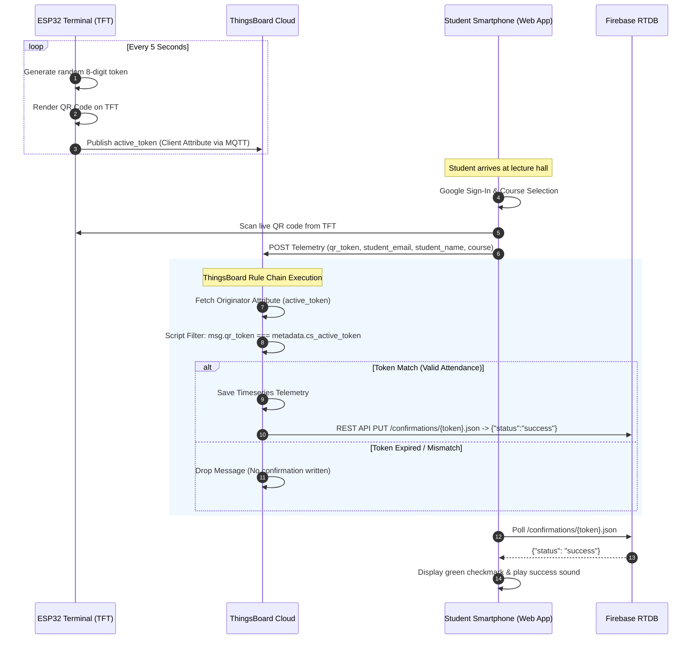

# 🏛️ System Architecture & Data Flow

This document details the architectural design, security protocols, and communication lifecycle of the **Smart Attendance System**.

---

## 1. Architectural Challenge & Solution

When designing an enterprise-grade IoT attendance system on **ThingsBoard Cloud Free/Community tier**, standard architectures encounter two hard platform limits:
1. **Asset Limitation:** Max 5 Assets allowed per tenant.
2. **User Account Limitation:** Max 5 User accounts allowed per tenant.

If a university class has 100 students across 6 courses, creating 100 ThingsBoard user logins or dedicated assets is impossible without a paid subscription.

### The Hybrid Solution
We decouple **device telemetry management** from **student identity management**:
* **Identity Management:** Offloaded to **Firebase Authentication** (Google OAuth 2.0). Students sign in using their institutional `@gmail.com` accounts. Unlimited users at zero cost.
* **IoT Rule Validation & Timeseries:** Managed by **ThingsBoard Cloud**. All attendance records are saved as timeseries telemetry on the physical Terminal device.
* **Confirmation Bridge:** ThingsBoard Rule Engine makes a lightweight REST call back to **Firebase Realtime Database** to notify the student's browser of attendance success.

---

## 2. Sequence Diagram



---

## 3. Anti-Spoofing & Security Model

| Threat | Vulnerability in Traditional Systems | Hybrid System Defense |
|---|---|---|
| **Photo Sharing (Proxy Attendance)** | Absent student receives photo of static QR code via WhatsApp and scans it from home. | The QR code rotates every **5 seconds**. By the time a student snaps a photo and sends it, the token is already expired and rejected by ThingsBoard. |
| **Token Guessing / Brute Force** | Guessing sequential identifiers. | Tokens are 8-digit cryptographically pseudo-random integers (`10000000` to `99999999`). Only 1 token is valid within any given 5-second window. |
| **Identity Forgery** | Entering someone else's student ID or email. | The web app forces **Google Sign-In**. The student's verified profile email is automatically extracted from Google OAuth tokens and locked in the telemetry payload. |
| **Browser CORS Restrictions** | Web browsers block cross-origin POST requests to external IoT endpoints. | Uses `mode: 'no-cors'` combined with `Content-Type: text/plain` payload dispatch, allowing telemetry to pass without preflight blockage. |

---

## 4. Telemetry Payload Format

When a student scans the QR code, the web client sends this JSON payload to ThingsBoard:

```json
{
  "qr_token": 84729103,
  "student_name": "Gayan Bandara",
  "student_email": "gayan@example.com",
  "course": "IIoT-Batch02"
}
```

* **Target Endpoint:** `https://eu.thingsboard.cloud/api/v1/{DEVICE_ACCESS_TOKEN}/telemetry`
* **Method:** `POST`
