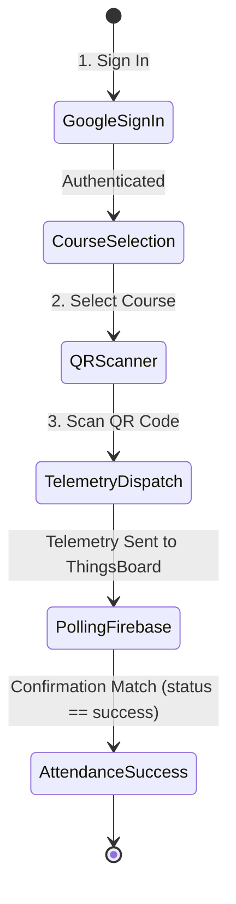

# 🌐 Student Web Application

The student web application is a mobile-responsive Progressive Web Application (PWA) hosted on **Firebase Hosting**. It provides an intuitive, frictionless 3-step check-in flow for students.

---

## 1. User Journey



### Step 1: Sign in with Google
Students authenticate securely using their existing Google accounts. The application automatically captures:
* `student_name`: Display name from Google Profile
* `student_email`: Verified institutional email address

### Step 2: Course Selection
Courses are dynamically loaded from Firebase Realtime Database (`/courses`). The lecturer or admin can add, remove, or modify active courses anytime from the ThingsBoard dashboard widget.

### Step 3: QR Code Scanning
The web app opens the smartphone's rear camera using the HTML5 `html5-qrcode` library. As soon as the student points their camera at the ESP32 terminal display, the active 8-digit token is extracted.

---

## 2. Technical Implementation Highlights

### A. CORS-Free ThingsBoard Telemetry Dispatch
Standard browser `fetch()` requests with `application/json` trigger a CORS preflight (`OPTIONS`) request, which external IoT endpoints often reject.

To ensure instant, reliable telemetry delivery directly from the browser:
```javascript
// Telemetry POST bypass technique
fetch(`https://eu.thingsboard.cloud/api/v1/${TB_ACCESS_TOKEN}/telemetry`, {
  method: 'POST',
  mode: 'no-cors',
  headers: {
    'Content-Type': 'text/plain' // Skips browser CORS preflight check
  },
  body: JSON.stringify({
    qr_token: parseInt(scannedToken),
    student_name: currentUser.displayName,
    student_email: currentUser.email,
    course: selectedCourse
  })
});
```
* **Why it works:** ThingsBoard's HTTP telemetry parser automatically parses valid JSON payloads even when received with `Content-Type: text/plain`. Using `mode: 'no-cors'` prevents browser security policy blocks.

### B. Two-Way Confirmation Loop
After dispatching telemetry to ThingsBoard, the student's browser immediately starts polling Firebase Realtime Database at:
```
https://smart-attendance-system-c3110-default-rtdb.firebaseio.com/confirmations/${qr_token}.json
```
* **Interval:** Every 1 second for up to 10 seconds.
* **Result:** As soon as ThingsBoard's Rule Engine verifies the token and writes `{"status": "success"}`, the polling receives the update, stops the camera, plays a confirmation chime, and displays the **Green Success Card**.

---

## 3. Deployment Guide

The web application is located in the `public/` directory and is managed via the Firebase CLI:

```bash
# 1. Install Firebase Tools (if not already installed)
npm install -g firebase-tools

# 2. Login to Firebase
firebase login

# 3. Deploy to production
firebase deploy --only hosting
```

* **Live Production URL:** `https://smart-attendance-system-c3110.web.app`
