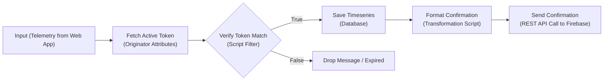

# ⚙️ ThingsBoard Rule Engine & Workflow

The ThingsBoard Rule Engine acts as the central validation gateway and bridge in the hybrid architecture. It enforces token validation, saves attendance timeseries records, and writes confirmation statuses to Firebase.

---

## 1. Complete Rule Chain Topology



---

## 2. Node-by-Node Setup Instructions

### Node 1: Fetch Active Token
* **Node Type:** `Enrichment - originator attributes`
* **Configuration:**
  * Check **Client attributes**
  * Add attribute key: **`active_token`**
* **Purpose:** Pulls the terminal's currently active token from the database and attaches it to the message metadata as `metadata.cs_active_token`.

---

### Node 2: Verify Token Match
* **Node Type:** `Filter - script`
* **Language:** **JavaScript**
* **Filter Code:**
  ```javascript
  return msg.qr_token === metadata.cs_active_token;
  ```
* **Purpose:** Checks if the scanned token in the incoming message body (`msg.qr_token`) matches the live active token published by the physical terminal (`metadata.cs_active_token`).
* **Routing:**
  * **True:** Routes to *Save Timeseries*.
  * **False:** Message is discarded. Anti-spoofing protection stops expired tokens here.

---

### Node 3: Save Timeseries
* **Node Type:** `Action - save timeseries`
* **Purpose:** Persists `student_name`, `student_email`, `course`, and `qr_token` to the ThingsBoard PostgreSQL timeseries database. This permanently records the student's attendance timestamp.

---

### Node 4: Format Confirmation
* **Node Type:** `Transformation - script`
* **Language:** **JavaScript**
* **Script Code:**
  ```javascript
  msg.status = "success";
  return {
    msg: msg,
    metadata: metadata,
    msgType: msgType
  };
  ```
* **Purpose:** Injects `status: "success"` into the message payload so Firebase can store it for client confirmation polling.

---

### Node 5: Send Confirmation to Firebase
* **Node Type:** `External - rest api call`
* **Endpoint URL:**
  ```
  https://smart-attendance-system-c3110-default-rtdb.firebaseio.com/confirmations/$[qr_token].json
  ```
* **Request Method:** `PUT`
* **Headers:**
  * `Content-Type`: `application/json`

> [!IMPORTANT]
> **ThingsBoard URL Placeholder Syntax:**
> * `$[key]` references a field in the **Message Body** (e.g. `$[qr_token]`).
> * `${key}` references a field in the **Metadata** (e.g. `${cs_active_token}`).
> Since `qr_token` exists in the telemetry payload, `$[qr_token]` must be used in the REST URL.
