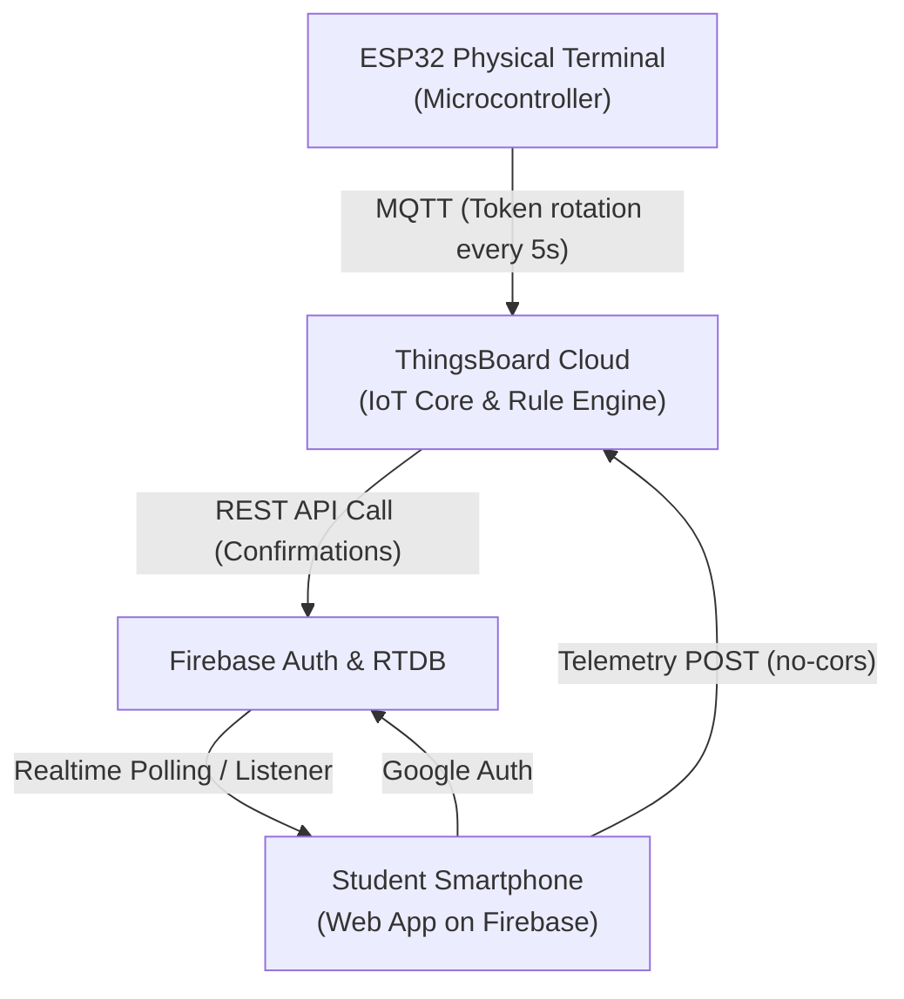

# 🎓 Smart Attendance System & IIoT Lab Wiki

Welcome to the official documentation wiki for the **Smart Attendance System** and the **IIoT Batch 02 Lab Exercises**.

---

## 📌 Table of Contents

| Page | Description |
|------|-------------|
| **[1. System Architecture](01-System-Architecture.md)** | Hybrid architecture (ThingsBoard Cloud + Firebase), security model, sequence diagrams |
| **[2. Hardware & Firmware](02-Hardware-and-Firmware.md)** | ESP32 pinouts, ILI9341 TFT SPI wiring, firmware token rotation logic |
| **[3. Student Web Application](03-Web-Application.md)** | Firebase Hosting, Google Authentication, QR Scanner, telemetry dispatch |
| **[4. ThingsBoard Rule Engine](04-ThingsBoard-Rule-Engine.md)** | Complete rule chain setup, JavaScript filters, REST API call to Firebase RTDB |
| **[5. Wokwi Simulation Guide](05-Wokwi-Simulation-Guide.md)** | How to simulate all hardware circuits and firmware in Wokwi |
| **[6. IIoT Batch 02 Exercises](06-IIoT-Batch02-Exercises.md)** | Proximity Alarm, Master Sorter, Smart Room Node, Industrial Laundry |

---

## 🚀 Quick Overview

### The Problem
Traditional classroom attendance methods (roll calls, paper sign-in sheets, static RFID cards, static printed QR codes) suffer from:
* **Time Inefficiency:** Taking attendance for 50+ students eats into lecture time.
* **Proxy Attendance / Buddy Punching:** Students take photos of static QR codes and send them to absent peers.
* **Platform Constraints:** ThingsBoard Cloud Community Edition enforces strict limits (max 5 assets, max 5 user accounts), preventing traditional 1-user-per-student IoT architectures.

### The Solution: Hybrid IIoT Architecture
This project implements a secure, scalable, and zero-subscription-cost hybrid system:
1. **Physical Terminal (ESP32 + TFT):** Generates an autonomous, rotating dynamic QR code every **5 seconds** and synchronizes the active token to ThingsBoard Cloud via MQTT.
2. **Student Web App (Firebase):** Students authenticate via **Google Sign-In**, select their enrolled course, scan the live QR code, and submit attendance telemetry directly to ThingsBoard.
3. **ThingsBoard Cloud Rule Engine:** Intercepts the telemetry, cross-checks the scanned token against the terminal's live `active_token`, writes attendance logs if valid, and sends a real-time status update to Firebase Realtime Database.
4. **Instant Feedback:** The student's smartphone displays an instant **"Attendance Confirmed"** checkmark without needing individual ThingsBoard accounts.

---

## 🛠️ Tech Stack & Ecosystem

* **Microcontroller:** ESP32 DevKit V1 (ESP-WROOM-32)
* **Display:** 2.8" or 2.4" ILI9341 320x240 SPI TFT Display
* **IoT Platform:** ThingsBoard Cloud (EU Instance)
* **Cloud & Auth:** Google Firebase (Hosting, Authentication, Realtime Database)
* **Firmware Framework:** Arduino C++ / ESP-IDF
* **Simulation:** Wokwi IoT Simulator
